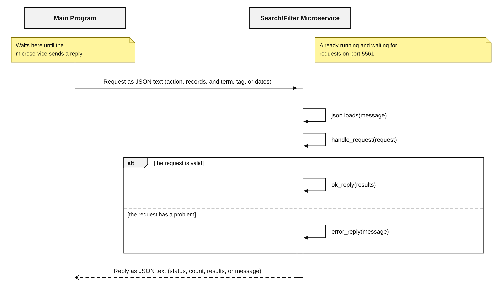

# Search/Filter Microservice

## What this microservice does

The Search/Filter microservice takes a list of records and returns only the records you ask for. It never changes the records you send. It does not know anything about your program, so it works with any kind of record, such as characters, trips, study cards, or movies.

It can do three things:

* **search**: return the records that contain a word anywhere in their text (upper or lower case does not matter)
* **filter_tag**: return the records that have an exact tag
* **filter_date**: return the records whose date falls between a start date and an end date (both dates are included)

The microservice uses ZeroMQ with the Request Reply pattern and listens on port **5561**. All messages are JSON text.

## How to run it

1. Install the ZeroMQ library for Python: `py -m pip install pyzmq`
2. Start the microservice and leave it running: `py search_filter_service.py`
3. To stop it, press the Control key and the C key together.

## How to REQUEST data from the microservice

Connect a ZeroMQ REQ socket to `tcp://localhost:5561`, turn your request into JSON text, and send it. Send one request at a time. The microservice sends back exactly one reply for each request.

Request parameters:

* `action` (required): `"search"`, `"filter_tag"`, or `"filter_date"`
* `records` (required): a list of records. Each record is an object. Useful fields are `id`, `name`, `tags` (a list of words), `date` (written as MM/DD/YYYY), and `notes`. A record that is missing a field is skipped, not rejected.
* `term` (required for search): the text to look for
* `tag` (required for filter_tag): the exact tag to look for
* `start_date` and `end_date` (required for filter_date): written as MM/DD/YYYY

Example request call (Python with pyzmq):

```python
import zmq, json

context = zmq.Context()
socket = context.socket(zmq.REQ)
socket.connect("tcp://localhost:5561")

request = {
    "action": "search",
    "records": [
        {"id": 1, "name": "Aria", "tags": ["elf"],
         "date": "03/15/2026", "notes": "Fears dragons"},
        {"id": 2, "name": "Brom", "tags": ["dwarf"],
         "date": "04/02/2026", "notes": "Loves ale"}
    ],
    "term": "dragon"
}
socket.send_string(json.dumps(request))
```

The other two requests are sent the same way, with different fields:

```python
{"action": "filter_tag", "records": [...], "tag": "elf"}
{"action": "filter_date", "records": [...], "start_date": "03/01/2026", "end_date": "03/31/2026"}
```

## How to RECEIVE data from the microservice

After you send a request, wait for the reply on the same socket. The reply is JSON text, so turn it back into a Python dictionary with `json.loads`.

If the request worked, the reply looks like this:

```json
{"status": "ok", "count": 1, "results": [ ...the matching records... ]}
```

The matching records come back exactly as you sent them, in the same order. If nothing matches, `count` is 0 and `results` is an empty list.

If something is wrong with the request, the reply looks like this, and the microservice keeps running so it can answer your next request:

```json
{"status": "error", "message": "...what went wrong..."}
```

Possible error messages:

* `Request must be valid JSON text`
* `Request must be a JSON object`
* `Unknown action: <the action you sent>`
* `records is required and must be a list`
* `term is required for search`
* `tag is required for filter_tag`
* `start_date and end_date are required for filter_date`
* `start_date and end_date must be written as MM/DD/YYYY`
* `start_date must not be after end_date`

Example receive call (Python with pyzmq), which continues from the request above:

```python
reply = json.loads(socket.recv_string())

if reply["status"] == "ok":
    print(reply["count"], "matches")
    for record in reply["results"]:
        print(record["name"])
else:
    print(reply["message"])
```

Example reply for the request above:

```json
{"status": "ok", "count": 1, "results": [{"id": 1, "name": "Aria", "tags": ["elf"], "date": "03/15/2026", "notes": "Fears dragons"}]}
```

## UML sequence diagram

This diagram shows how a request and a reply travel between your program and the microservice.



## How to test it

1. Start the microservice: `py search_filter_service.py`
2. Open a second PowerShell window in the same folder and run the test program: `py test_search_filter.py`
3. The test program prints each request, each reply, and PASS or FAIL for each test.